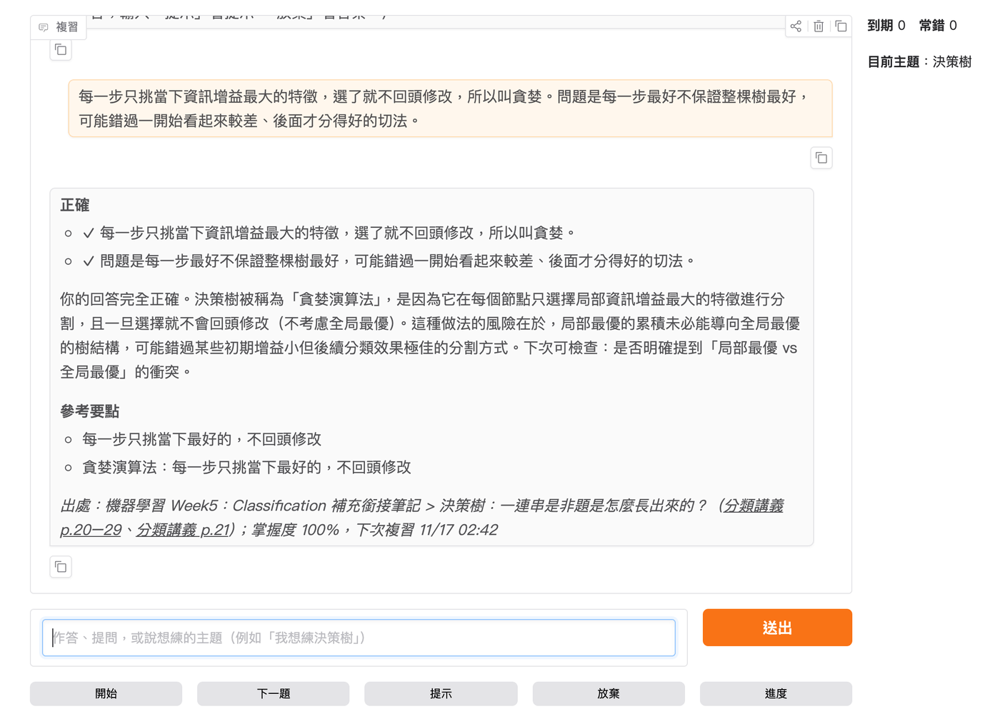
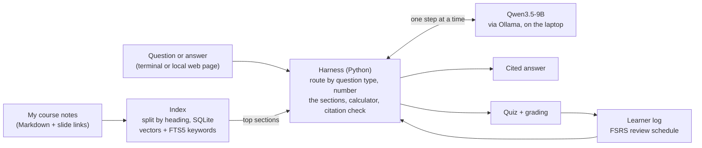
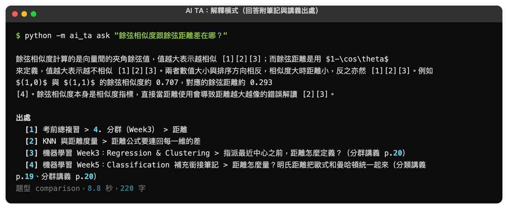
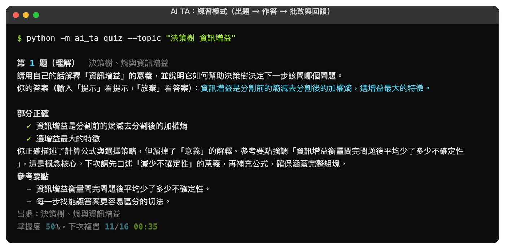
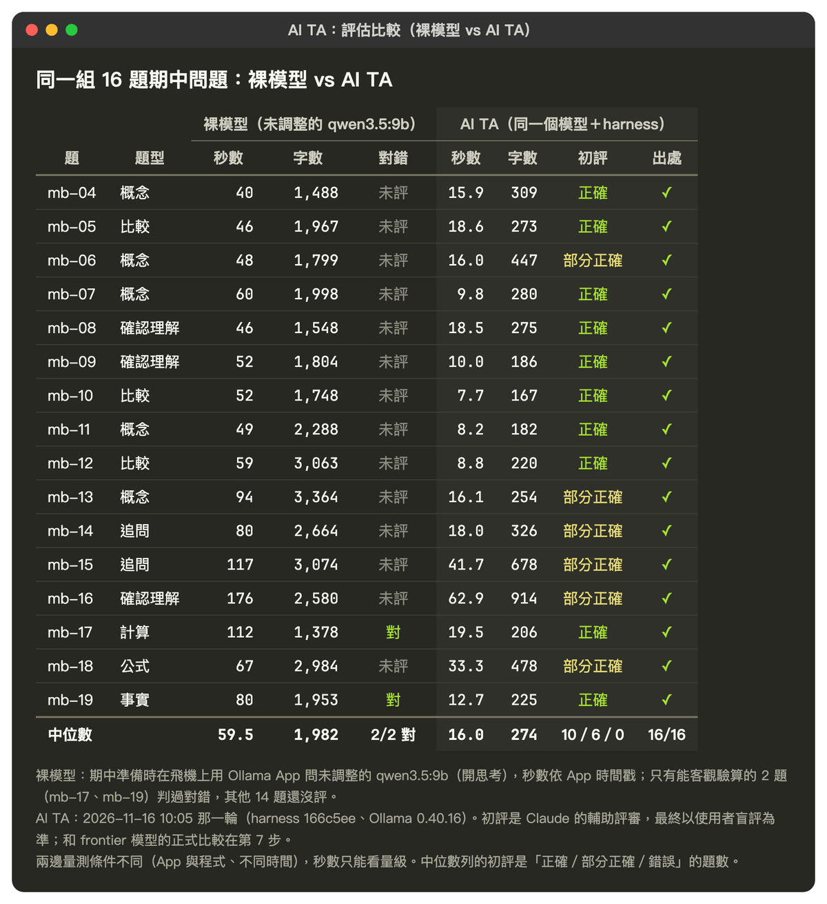

# Offline AI TA



*The local review page (UI text is in Traditional Chinese, the language of my notes). I answered a quiz question; the TA marked each point, explained, and cited the note section and slide pages it graded against.*

**An offline teaching assistant for exam review in a university machine learning course.** It runs a local 9B model (Qwen3.5-9B via [Ollama](https://ollama.com)) on a laptop and pairs retrieval over my own course notes with a code-driven harness, so a small model can answer with citations, generate quizzes and check understanding without internet.

[中文版 README](README.zh-TW.md)

## What it does

- **Answers with citations.** Each sentence carries `[n]` markers that point to note sections and slide pages; code checks every marker before the answer is shown and retries once if the check fails.
- **Generates and grades quizzes.** Questions come from my notes; free-text answers are graded against the note's own key points, not the model's memory.
- **Checks understanding.** When I state something in my own words, it splits the statement into claims and judges each against the notes (correct, needs fixing, wrong, or not in the notes).
- **Tracks what I get wrong.** Every attempt is logged; mastery and the next review time are scheduled with FSRS (a spaced-repetition algorithm), and missed points come back first.
- **Stays offline.** Both models run in Ollama with cloud features disabled.

## How it works

The program, not the model, controls the flow. The 9B model does one short, single-turn language task per step, always with the note text in the prompt.



- **Index:** notes are split at the smallest heading, embedded with `qwen3-embedding:0.6b`, and stored in SQLite with an FTS5 keyword index. Vector search is the default; keyword and hybrid search are options.
- **Harness:** prompts, guardrails and per-mode instructions are plain text in [`dev/harness/`](dev/harness/), so every change is a diff. Calculation questions go to a restricted calculator instead of the model's arithmetic.
- Full design: [`docs/architecture.md`](docs/architecture.md) and the decision log in [`docs/decisions/`](docs/decisions/) (Traditional Chinese).

## Results so far



*Explain mode: a short answer where every claim points to a numbered note section; the footer shows question type, time and length.*



*Practice mode: question, my answer, point-by-point grading against the note's key points, then mastery and next review time.*



*The 16 questions I asked a bare `qwen3.5:9b` while preparing for the midterm, rerun through the AI TA (run `2026-11-16-1005`). Median answer: 59.5 s and 1,982 characters for the bare model versus 16.0 s and 274 characters for the AI TA, which cited its notes on all 16. The two sides were measured differently (Ollama app versus this program), so the times only show the order of magnitude. The AI TA's correct / partially correct / wrong counts (10 / 6 / 0) are a first-pass review by Claude, not a final grade, and only 2 bare-model answers were checked.*

Raw runs and reviews are in [`dev/eval/runs/`](dev/eval/runs/); the question sets and method are in [`dev/eval/README.md`](dev/eval/README.md).

## Quick start

It needs [Ollama](https://ollama.com), Python 3.12 or newer, and your own course notes (this repository does not include any).

```bash
ollama pull qwen3.5:9b && ollama pull qwen3-embedding:0.6b
python -m venv .venv && .venv/bin/pip install -r requirements.txt
```

The notes are read in place: put this folder inside your notes folder and edit the patterns in [`data/knowledge/sources.json`](data/knowledge/sources.json). Then build the index and start a review session:

```bash
PYTHONPATH=dev/src .venv/bin/python -m ai_ta index        # split notes, keyword index
PYTHONPATH=dev/src .venv/bin/python -m ai_ta embed        # vectors
PYTHONPATH=dev/src .venv/bin/python -m ai_ta web --open   # local page at 127.0.0.1:7860
```

Terminal commands (`search`, `ask`, `quiz`, `review`, `progress`) are listed in [`dev/README.md`](dev/README.md).

## Limitations

- **Work in progress.** The planned comparison of the bare model, the AI TA and a frontier model on the same questions, graded blind by me, has not been run yet, so the core hypothesis below is still untested.
- **Correctness labels are provisional.** Current verdicts come from an AI reviewer (Claude) and will be replaced by my blind grading.
- **One course, one learner.** It is tuned on my own Chinese notes for one machine learning course and has not been tried on other subjects or by other students.
- **Bounded by the notes.** When the notes do not cover a point, the TA is designed to say so rather than fill the gap from memory.

## Why and how it was built

- **Works without internet.** I first tried a bare local model while studying for the midterm on a flight. The answers were readable but not good enough, and nothing had been tuned. This project builds on that experience.
- **Personalized.** It is grounded in my own lecture notes and quiz history, so it is not a generic chatbot.
- **Course requirement.** It is built for the Machine Learning course at National Central University (Fall 2026), where students build their own AI TA on a local model.

**Core hypothesis:** on scoped review tasks with course materials available, a 9B local model with a well-designed harness (prompts, tools, memory, workflow) can approach the quality of frontier models. The planned test runs the same question set on three setups: the bare local model (baseline), the AI TA (the same model plus this harness), and a frontier model given the same materials (reference ceiling, used only for evaluation).

**Approach:** research how others build course tutors and run agents on small models ([`research/`](research/)), decide the design ([`docs/decisions/`](docs/decisions/)), build a minimal offline version and then the interface (`dev/`), then evaluate and report (`reports/`). The step order is in [`docs/plan.md`](docs/plan.md); the project overview is in the [proposal](reports/2026-11-11-proposal.md).

## Repository layout

| Folder | Contents |
|---|---|
| `research/` | Source notes rated by evidence strength (A/B/C), search logs, synthesis (Traditional Chinese) |
| `docs/` | Plan, course requirements, design decisions (Traditional Chinese); README images in `docs/images/` |
| `dev/` | Code, harness (prompts, tool descriptions), interface, evaluation |
| `data/` | Runtime data manifests; course files are not redistributed |
| `reports/` | Write-ups for readers outside the project (English and Traditional Chinese) |

Not published: AI interaction logs, personal study data, paper PDFs, and course materials.

## License

[MIT](LICENSE)
